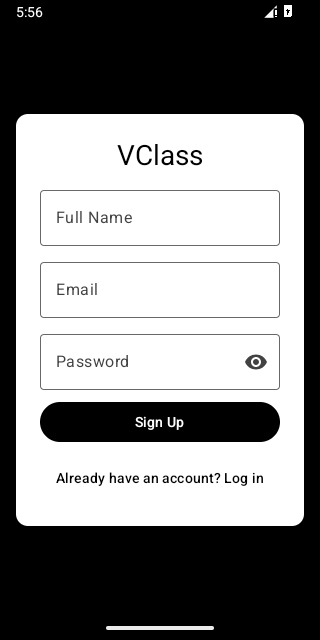
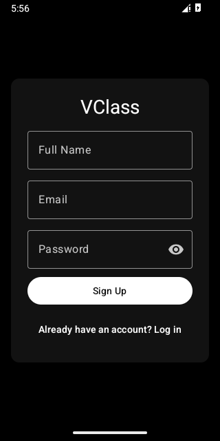
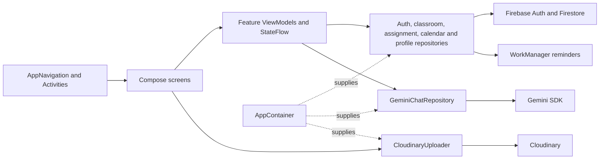

# VClass

VClass is a native Android virtual classroom and AI study assistant. Teachers and students can share class material, keep assignments and submissions together, and use an AI tutor for follow-up study questions.

## What the app does

- **Classrooms** — Create or join a class by code, view its roster, and manage membership according to the creator, teacher, or student role. Creators can archive a class.
- **Assignments and resources** — Share announcements and files, create assignments with optional due dates, and review submissions by assignment. Assignments with the same title have separate document IDs and submission lists.
- **Study tools** — Ask the Gemini tutor a question and continue the conversation. Create private calendar events, save announcements as events, and schedule reminders.
- **Account** — Register, sign in, request a password reset, update profile details and a photo, and sign out.

## App preview

 

The screenshots show the app on an Android emulator with the current black-and-white theme. See the [manual verification guide](docs/manual-verification.md) for a signed-in demo sequence.

## Stack and architecture

Kotlin, Jetpack Compose, Material 3, AndroidX ViewModels, StateFlow, and coroutines power the Android app. Firebase Authentication handles identities, Firestore stores classroom and user data, Cloudinary hosts files uploaded with OkHttp, Gemini provides tutor replies, and WorkManager schedules reminders. Realm is bundled, and the current manifest starts the app without the legacy Realm application class.



| Path | What’s there |
|---|---|
| `app/src/main/java/com/example/vclass/feature/` | Authentication, dashboard, classrooms, calendar, profile, and chat |
| `app/src/main/java/com/example/vclass/data/` | Firebase repositories, Gemini client, uploads, and reminder scheduling |
| `app/src/main/java/com/example/vclass/{core,di,domain,navigation}/` | Shared UI and configuration, dependencies, models, and activity routing |
| `app/src/test/`, `app/src/androidTest/`, `tests/` | JVM tests, Android tests, and local Firestore authorization tests |
| `.github/workflows/`, `docs/` | CI, setup, architecture, security, and verification |

## Quick start

1. Clone the repository and open the project root in Android Studio.
2. Use Android Studio Otter 2 Feature Drop (2025.2.2) or a version that supports AGP 8.13. Select **JDK 21**, install **Android SDK 35** and **Build Tools 35.0.0**, and use the included **Gradle 8.13** wrapper. The app supports Android API 24 and later. [Android compatibility](https://developer.android.com/build/releases/about-agp)
3. Follow the [setup guide](docs/setup.md) to use an isolated Firebase project, configure optional Gemini and Cloudinary access, and launch the `app` debug configuration.

```powershell
git clone --branch refactor/professional-vclass https://github.com/abhighatkar18/VClass.git
cd VClass
.\gradlew.bat :app:assembleDebug :app:lintDebug :app:testDebugUnitTest
```

## Testing and CI

```powershell
.\gradlew.bat :app:connectedDebugAndroidTest
npm.cmd ci --ignore-scripts --no-audit --no-fund
npm.cmd run test:firestore
```

Android tests run on a signed-out disposable device or emulator. The Firestore suite uses a local emulator and synthetic users. GitHub Actions runs the credential-free Android and Firestore jobs and retains verification reports. See the [testing guide](docs/testing.md) for exact commands, coverage boundaries, and results.

## Security and release status

Use test accounts and a staging backend for live demos. A locally configured Gemini key is compiled into the APK and needs a server-side credential design before public distribution. The [security and release checklist](docs/security.md) tracks deployed Firestore rules, Cloudinary restrictions, historical data, dependency warnings, and release signing. Physical-device checks and end-to-end staging verification are tracked in the [manual checklist](docs/manual-verification.md).

Further reading: [Architecture](docs/architecture.md) · [Setup](docs/setup.md) · [Testing](docs/testing.md) · [Security and release](docs/security.md)
