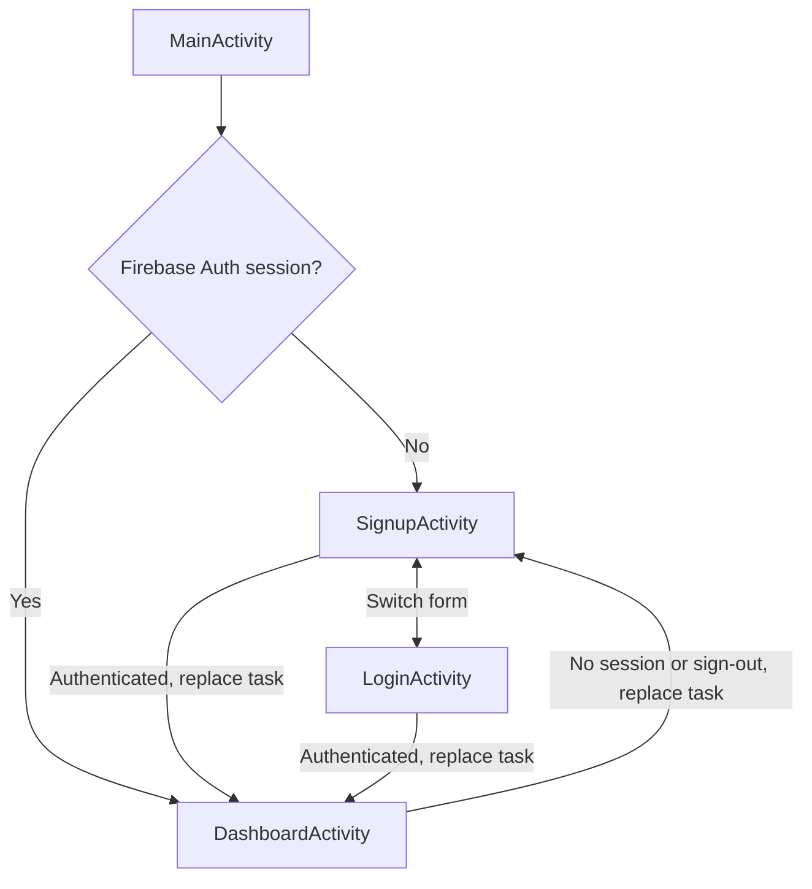

# Architecture

VClass uses activities for the authentication boundary and Compose for feature screens. The dashboard owns the Home, Calendar, Chatbot, and Profile tabs. Feature ViewModels handle asynchronous state and expose StateFlow, which the UI collects with lifecycle awareness. Some short-lived classroom dialog operations run in a Compose coroutine scope tied to the dialog.

| Package | Responsibility |
|---|---|
| `navigation` | Launcher routing and task replacement after sign-in or sign-out |
| `feature` | Screens, dialogs, ViewModels, and feature state |
| `core/ui` | Material 3 styling, shared UI, and loading / ready / failed content state |
| `domain` | Classroom, assignment, submission, role, and event representations |
| `di` | `AppContainer` creates Firebase services and supplies repositories and upload clients |
| `data/firebase` | Identity, profile provisioning, classrooms, assignments, profiles, and calendar data |
| `data/gemini`, `data/cloudinary`, `data/notification` | Tutor replies, streamed file uploads, and unique reminder jobs |

## Sessions

Firebase Authentication owns passwords. Registration provisions the Firestore profile with name and email. It can sign in successfully even if profile provisioning needs a retry through Profile. Dashboard observes the current session while started and routes signed-out users back to sign-up. The launcher has no fixed splash delay, and fetching auth session state does not construct Firestore.

## Data and async operations

- **Classrooms.** The list starts from the signed-in user's private classroom index. The repository deduplicates class codes, reads up to four documents at a time, and filters out stale, archived, or inaccessible entries. Class detail owns its ViewModel and snapshot listeners for the lifetime of the screen. Firestore rules enforce access on the server.
- **Assignments.** Firestore assigns each new assignment a document ID. UI actions pass that ID through file selection and into `classes/{code}/assignments/{assignmentId}/submissions/{submissionId}`. Created submission drafts carry a stable ID so a retry can recognize an already saved record. Historical document IDs are passed through as stored.
- **Calendar.** Events live under the user's private profile. Snapshot observers avoid repeated enqueue requests when confirmed event dates have not changed. WorkManager uses a unique key per user and event. The worker checks the session, permission, and server event before posting.
- **Gemini.** `ChatViewModel` keeps the transcript and conversation history for the dashboard session. It builds the educational prompt and invokes `GeminiChatRepository`. The repository uses the configured `gemini-3.5-flash-lite` model with the existing SDK and bounded retries for temporary errors. The UI accepts a new send when the active request finishes.
- **Files and profiles.** Uploads stream content from the Android document picker using OkHttp. Firestore stores the returned HTTPS URL. Profile photos use bounded decoding off the main thread. Realm remains a bundled dependency with an unregistered legacy initializer.

See [security boundaries](security.md) and the [regression matrix](testing.md).
